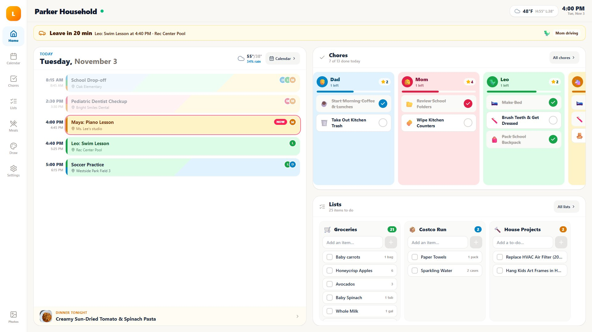

# Changelog

Each release's notes on GitHub come from its section here. Before tagging `vX.Y.Z`, rename
`## [Unreleased]` to `## [X.Y.Z] - YYYY-MM-DD` and start a fresh `## [Unreleased]` above it.
The release workflow stops if the tagged version has no section.

## [Unreleased]

## [0.1.0] - 2026-11-05

**Lucarne's first public release.** Lucarne is a self-hosted family hub for a wall touchscreen: a shared calendar, chores and rewards, meal planning, grocery lists and a photo frame. Everything runs on a Raspberry Pi or small PC in your home, your data is one SQLite file on that device, and there's no subscription.



## What's in it

- **Home screen:** today's calendar, each person's chores, tonight's dinner, the weather and every list, all on one screen.
- **Calendar:** two-way Google Calendar sync for several accounts, `.ics` links (school, TeamSnap, iCloud, Outlook), birthdays and holidays, countdowns, and "leave in 12 min" alerts with drive times.
- **Chores, routines, habits and rewards:** kids earn stars, spend them on rewards, and have a picture-based **Kid Mode** for those who can't read yet.
- **Lists and groceries:** items sorted by store aisle, quantities merged, one-tap "usual items", and optional Google Keep sync ("Hey Google, add milk").
- **Meals:** a weekly planner, a recipe box, recipe import from a URL without the ads, a full-screen Cook Mode with timers, and ingredients sent to the grocery list.
- **Draw:** a crayon, marker and paint pad for little kids. Their drawings show up in the photo screensaver.
- **Photo screensaver:** Google Photos Picker, shared albums of any size, or your own uploads, stored locally.
- **Built for a wall:** an on-screen keyboard, large touch targets, offline mode, and automatic daily backups with one-tap restore.
- **Phone companion:** any phone on your home Wi-Fi gets the same app with a mobile layout.
- **Optional AI features** using your own Gemini key: Magic Import pulls events from a photo of a flyer, meal search finds real recipes, and Plan my week fills your dinners.

## Install

**Try it on your computer** (Node.js 22.5+):
```bash
git clone https://github.com/el-dud3rino/Lucarne.git
cd Lucarne && npm install && npm run build && npm start
```
Then open http://localhost:3001. It starts with a demo family you can rename or delete.

**On a Raspberry Pi:** download `lucarne-v0.1.0.tar.gz` below. It's prebuilt, so there's no build step. Then follow the [Raspberry Pi guide](https://github.com/el-dud3rino/Lucarne#installing-on-a-raspberry-pi-wall-display).

Recommended hardware: a Raspberry Pi 5 (4 GB) booting from an SSD, and a 15–24" 1920×1080 touchscreen.

## This is an early release, so feedback is welcome

Lucarne is new and has mostly been tested on Windows so far, so expect rough edges. Testers running it on a Raspberry Pi or in Docker are especially welcome.

- 🐛 Found a bug? [Open an issue](https://github.com/el-dud3rino/Lucarne/issues).
- 💬 Ideas, questions, or a photo of your setup? Post in [Discussions](https://github.com/el-dud3rino/Lucarne/discussions).
- ⭐ If it's useful to you, a star helps other families find it.

*Lucarne is an independent project and is not affiliated with or endorsed by Skylight.*
